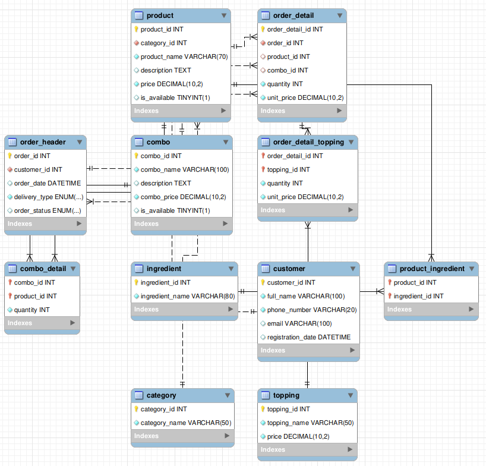
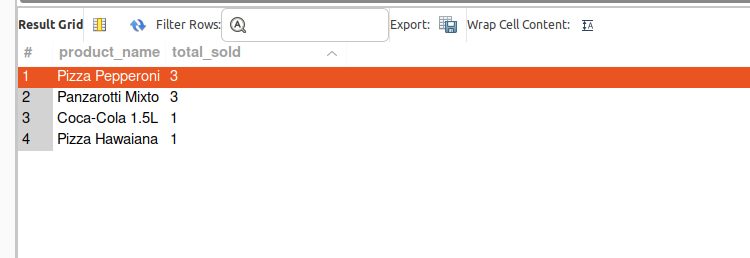
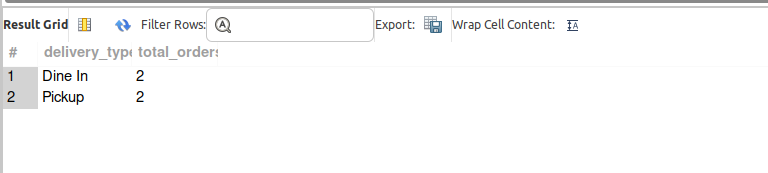
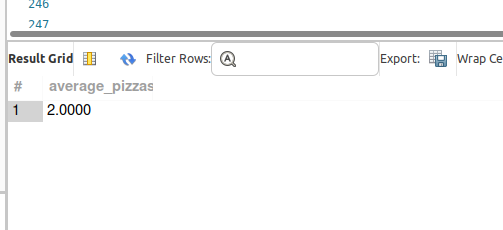
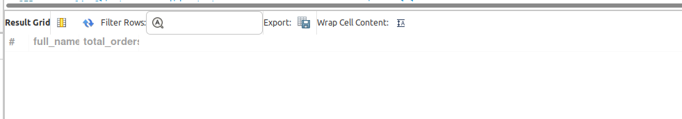
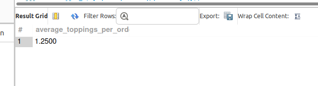
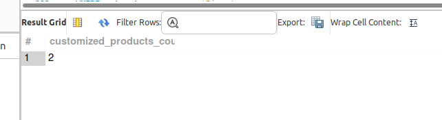
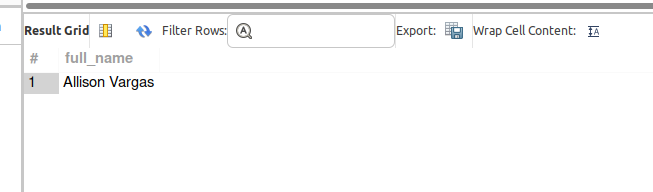

# 🍕 Base de Datos de una Pizzería · MySQL

[](https://github.com/allisonrvargas/pizzeria-mysql/actions/workflows/ci.yml)
[](LICENSE)

Base de datos en **MySQL** para una pizzería: clientes, productos, ingredientes, categorías, combos, pedidos y adiciones personalizadas (11 tablas). Incluye el modelo lógico y físico, y consultas para analizar las ventas del negocio.

**Script completo:** [`allis.sql`](allis.sql)

**Temas:** modelado relacional · `JOIN` · `GROUP BY` · funciones de agregación (`SUM`, `COUNT`)

> Proyecto final del módulo de bases de datos · Allison Rocío Vargas Mejía

## Cómo ejecutarlo

Requiere MySQL 8. Con Docker:

```bash
docker run --name pizzeria-mysql -e MYSQL_ROOT_PASSWORD=root -p 3306:3306 -d mysql:8.0
# espera unos segundos a que arranque y luego:
docker exec -i pizzeria-mysql mysql -uroot -proot < allis.sql
```

O con un MySQL local: `mysql -u root -p < allis.sql`. El script crea la base `pizzeria` con sus 11 tablas y los datos de ejemplo; el CI de este repositorio lo ejecuta en cada cambio.

# Diagramas

Modelo lógico y modelo físico 





# Consultas realizadas


    1. Productos más vendidos (pizza, panzarottis, bebidas, etc.)




    2. Total de ingresos generados por cada combo


    3. Pedidos realizados para recoger vs. comer en la pizzería


    4. Adiciones más solicitadas en pedidos personalizados


    5. Cantidad total de productos vendidos por categoría


    6. Promedio de pizzas pedidas por cliente


    7. Total de ventas por día de la semana


    8. Cantidad de panzarottis vendidos con extra queso


    9. Pedidos que incluyen bebidas como parte de un combo

No me salio ninguna consulta ya que no se hizo ningun pedido que incluyera bebidas como parte del combo 

    10. Clientes que han realizado más de 5 pedidos en el último mes


No me salio ninguna consulta ya que no se realizaron màs  de 5 pedidos en el ùltimo mes

    11. Ingresos totales generados por productos no elaborados (bebidas, postres, etc.)


    12. Promedio de adiciones por pedido


    13. Total de combos vendidos en el último mes


    14. Clientes con pedidos tanto para recoger como para consumir en el lugar


    15. Total de productos personalizados con adiciones


    16. Pedidos con más de 3 productos diferentes


    17. Promedio de ingresos generados por día


    18. Clientes que han pedido pizzas con adiciones en más del 50% de sus pedidos


    19. Porcentaje de ventas provenientes de productos no elaborados


    20. Día de la semana con mayor número de pedidos para recoger


