# EXAMEN FINAL:

#### Nombre: Allison Rocio Vargas Mejìa

# DIAGRAMAS:

Modelo lògico, modelo fìsico 

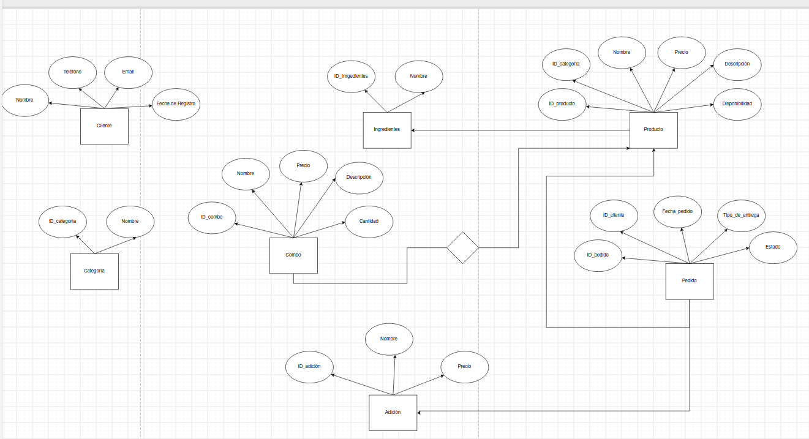

# Consultas a realizadas:

    1. Productos más vendidos (pizza, panzarottis, bebidas, etc.)

    2. Total de ingresos generados por cada combo

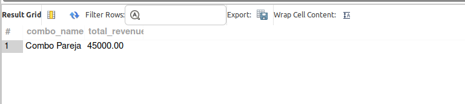

    3. Pedidos realizados para recoger vs. comer en la pizzería

    4. Adiciones más solicitadas en pedidos personalizados
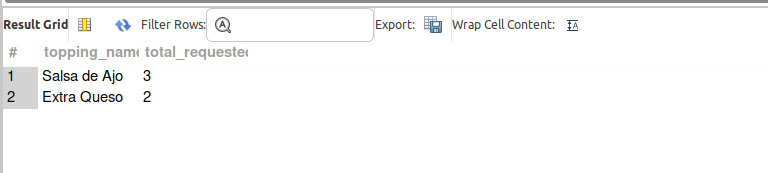

    5. Cantidad total de productos vendidos por categoría
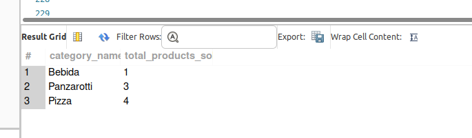

    6. Promedio de pizzas pedidas por cliente

    7. Total de ventas por día de la semana
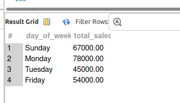

    8. Cantidad de panzarottis vendidos con extra queso
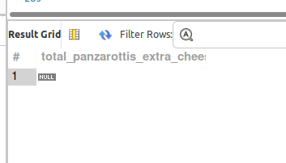

    9. Pedidos que incluyen bebidas como parte de un combo
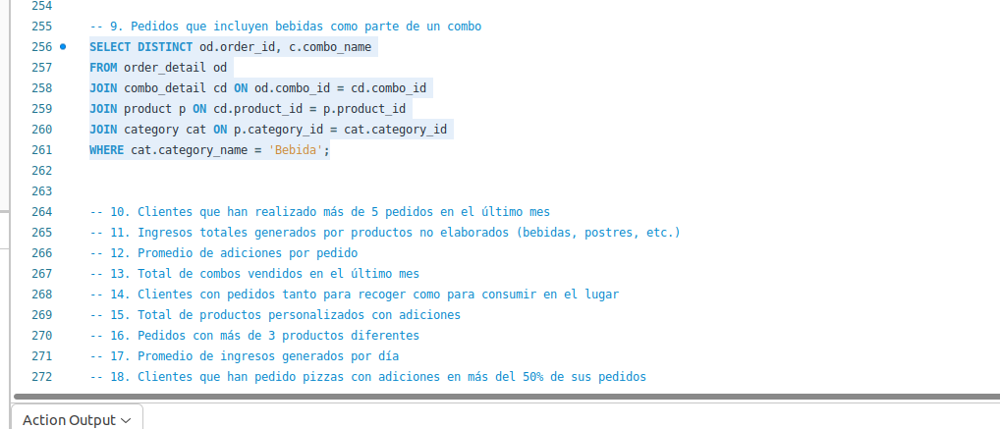
No me salio ninguna consulta ya que no se hizo ningun pedido que incluyera bebidas como parte del combo 

    10. Clientes que han realizado más de 5 pedidos en el último mes

No me salio ninguna consulta ya que no se realizaron màs  de 5 pedidos en el ùltimo mes

    11. Ingresos totales generados por productos no elaborados (bebidas, postres, etc.)
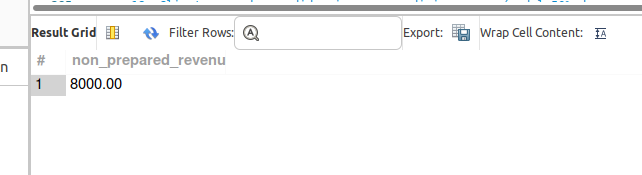

    12. Promedio de adiciones por pedido

    13. Total de combos vendidos en el último mes
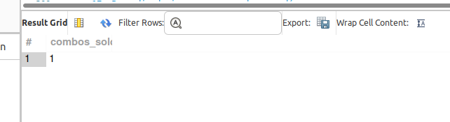

    14. Clientes con pedidos tanto para recoger como para consumir en el lugar
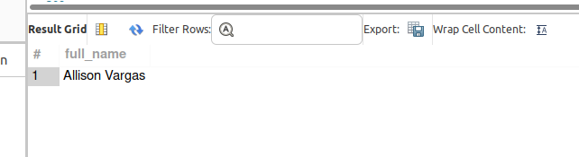

    15. Total de productos personalizados con adiciones

    16. Pedidos con más de 3 productos diferentes
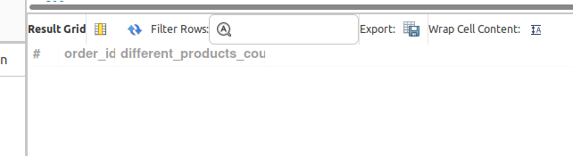

    17. Promedio de ingresos generados por día
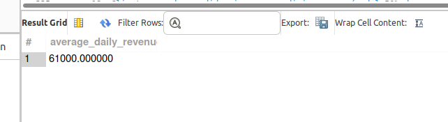

    18. Clientes que han pedido pizzas con adiciones en más del 50% de sus pedidos

    19. Porcentaje de ventas provenientes de productos no elaborados
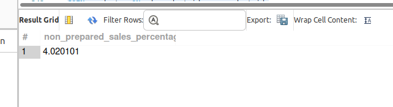

    20. Día de la semana con mayor número de pedidos para recoger

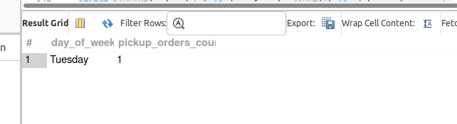
